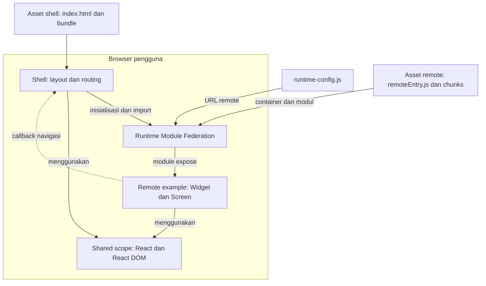

# MicroFE boilerplate

Boilerplate React + TypeScript dengan Webpack Module Federation. Shell memuat widget dan screen dari satu remote contoh. Styling komponen memakai CSS Modules. Remote dapat dijalankan sendiri dan dibuild terpisah.

## Arsitektur

Diagram berikut memperlihatkan integrasi saat aplikasi berjalan di browser. Shell dan remote menghasilkan asset terpisah; hosting dapat dipilih sesuai kebutuhan proyek.



Shell membaca URL remote dari runtime config. Federation memuat container `remoteEntry.js`, menginisialisasi shared scope, dan menyediakan module yang diekspos remote. Import melalui `React.lazy` memuat komponen widget atau screen; `Suspense` menampilkan loading, dan error boundary menampilkan fallback jika pemuatan atau render komponen gagal.

Remote mengelola state dan logic fitur, lalu meminta navigasi melalui callback dari shell. Shell menentukan perubahan URL. React dan React DOM dibagi lewat shared scope; setiap aplikasi tetap memiliki fallback dependency agar remote bisa berjalan standalone.

| Bagian                      | Tanggung jawab                                                                   |
| --------------------------- | -------------------------------------------------------------------------------- |
| `apps/shell`                | Layout, navigasi hash, komposisi remote, loading dan error fallback              |
| `apps/example`              | Widget dan screen contoh, state fitur, entry standalone                          |
| `packages/contracts`        | Tipe props dan callback sebagai batas integrasi                                  |
| `packages/ui`               | Komponen UI lokal yang dibundel oleh aplikasi pemakainya                         |
| `config/runtime-config.cjs` | Validasi environment dan URL remote, pembuatan konfigurasi publik                |
| `webpack.common.cjs`        | Konfigurasi build, expose/import Federation, shared dependencies dan CSS Modules |

UI dan contracts dihubungkan melalui npm workspaces saat development/build. Keduanya tidak diambil dari server dependency saat runtime. Shared scope adalah mekanisme runtime Federation, bukan aplikasi terpisah. Remote berjalan di konteks JavaScript browser yang sama dengan shell.

## Fondasi boilerplate

Boilerplate ini menyediakan pola yang bisa dipakai ulang tanpa domain bisnis tertentu:

- Shell dan satu remote contoh yang bisa dibuild dan dijalankan terpisah.
- Contract props/callback yang jelas; remote berkomunikasi dengan shell melalui contract.
- Konfigurasi development, staging dan production, dengan URL remote yang bisa diganti setelah build.
- Shared React dengan pemeriksaan versi, CSS Modules, ESLint dan Prettier.
- Loading, error fallback, tes standalone/integrasi, serta CI.

Untuk memakai boilerplate pada proyek baru, ganti fitur example, tentukan prefix route tiap remote, dan isi URL deployment. Auth, API client, state management, design tokens, logging, serta pipeline deployment dipilih sesuai kebutuhan proyek. Versi contract dan aturan rollback perlu disepakati sebelum remote dirilis oleh tim yang berbeda.

## Mulai

Gunakan Node.js 24 (`nvm use`), lalu:

```sh
npm ci
npm run dev
```

- Shell: http://localhost:3000
- Remote example: http://localhost:3001

Klik **Buka screen remote** untuk berpindah dari widget dashboard ke screen remote. Shell mengatur URL; remote menerima callback navigasi melalui contract.

## Struktur

```text
apps/shell       Layout, navigasi, runtime config, loading/error boundary
apps/example     Widget dan screen contoh, entry standalone
packages/ui      Komponen UI lokal untuk kedua aplikasi
packages/contracts  Tipe props untuk integrasi shell dan remote
scripts          Development, preview, validasi versi React
```

`packages/ui` dan `packages/contracts` adalah package workspace, bukan aplikasi atau server dependency tambahan. Keduanya disertakan pada build aplikasi yang menggunakannya.

## Shared dependencies

Konfigurasi ada di `webpack.common.cjs`. React dan React DOM memakai `singleton: true` agar runtime Federation menggunakan satu instance shared, `requiredVersion` dari manifest aplikasi, dan `strictVersion: true` agar versi yang tidak cocok ditolak. Setiap aplikasi tetap memiliki dependency dan fallback bundle sendiri untuk dapat berjalan standalone.

Gunakan versi React dan React DOM yang sama pada kedua manifest. `npm run check:dependencies` memeriksa kesesuaiannya. Library lain dapat menggunakan versi berbeda selama tidak bergantung pada identitas instance global yang sama.

## Konfigurasi remote

Shell membaca `runtime-config.js` sebelum menjalankan bundle. Webpack membuat file ini dari `MICROFE_ENV` dan `MICROFE_EXAMPLE_URL`; hanya kedua field publik yang diteruskan ke browser. Jangan memasukkan token atau secret ke konfigurasi frontend.

Tanpa konfigurasi tambahan, environment adalah `development` dengan remote di `http://localhost:3001/remoteEntry.js`. Untuk konfigurasi lokal, salin `.env.example` menjadi `.env.local`, lalu isi nilainya dan restart development server. Environment dari shell atau CI mengambil prioritas atas `.env.local`.

| Environment   | URL remote                                             |
| ------------- | ------------------------------------------------------ |
| `development` | Default localhost, bisa diganti dengan HTTP atau HTTPS |
| `staging`     | Wajib URL HTTPS milik deployment staging Anda          |
| `production`  | Wajib URL HTTPS milik deployment production Anda       |

Contoh build staging di macOS/Linux:

```sh
MICROFE_ENV=staging MICROFE_EXAMPLE_URL=https://remote-staging.your-domain.com/remoteEntry.js npm run build
```

Untuk Windows, isi `.env.local` atau atur environment melalui terminal/CI. Nama environment yang tidak dikenal, URL tidak valid, dan konfigurasi staging/production tanpa URL HTTPS membuat build shell gagal.

Untuk mengganti environment pada build yang sudah tersedia tanpa rebuild bundle:

```sh
MICROFE_ENV=production MICROFE_EXAMPLE_URL=https://remote.your-domain.com/remoteEntry.js npm run configure
```

Upload file `apps/shell/dist/runtime-config.js` yang dihasilkan ke deployment shell. Script `configure` membutuhkan build shell sebelumnya. Anda juga dapat memperbarui file runtime tersebut langsung di hosting.

Remote mengekspos `example/Widget` dan `example/Screen`. Untuk menambah remote, tambahkan app, nama container yang unik, konfigurasi `remotes`, deklarasi TypeScript, dan route atau area komposisinya.

Remote berjalan dengan hak akses JavaScript yang sama dengan shell. Gunakan hanya URL remote yang dipercaya, HTTPS di production, dan aturan CSP sesuai origin deployment. Authorization tetap harus ditegakkan di backend. Boilerplate ini belum menyediakan auth, API, atau konfigurasi production untuk hosting tertentu.

## CSS isolation

Shell, remote, dan UI memakai `*.module.css`. Import style sebagai object dan gunakan `className={styles['nama-class']}`. Class hasil build diberi hash serta namespace per aplikasi, sehingga selector remote tidak menargetkan class biasa milik fitur lain.

`apps/shell/src/global.css` hanya mengatur margin dokumen. Remote tidak boleh menambahkan selector global seperti `body`, `button`, atau `:global(...)`. CSS Modules membatasi selector, tetapi properti seperti font dan color tetap bisa diwariskan dari shell. Ini bukan sandbox CSS atau batas keamanan; gunakan Shadow DOM jika membutuhkan isolasi penuh.

## Standar kode

ESLint memeriksa JavaScript/TypeScript, penggunaan React Hooks, dan JSX. Prettier menangani format; aturan formatting yang bertabrakan dinonaktifkan melalui `eslint-config-prettier`.

```sh
npm run lint
npm run lint:fix
npm run format
npm run format:check
```

CI menjalankan lint tanpa warning dan format check melalui `npm run check`.

## Build dan verifikasi

```sh
npm run build
npm run preview
```

Build ada di masing-masing `apps/*/dist`. Deploy keduanya sebagai static assets; jangan menggabungkan direktori hasil build. Pertahankan chunk lama selama masih ada pengguna yang memuat versi sebelumnya. Hindari cache panjang untuk `remoteEntry.js` dan `runtime-config.js`; chunk dengan nama hash dapat dicache lebih lama.

```sh
npx playwright install chromium
npm run check
```

`check` menjalankan lint, format check, validasi dependency, TypeScript, tes konfigurasi environment, production build, dan tes browser. Tes mencakup remote nyata, callback navigasi, deep link, standalone remote, error fallback, route tidak dikenal, runtime URL, deployment shell di subpath, dan CSS isolation. `npm test` memerlukan hasil build sebelumnya. CI menjalankan proses yang sama.

Build aplikasi secara terpisah:

```sh
npm run build --workspace @microfe/shell
npm run build --workspace @microfe/example
```

Routing memakai hash sehingga static hosting tidak membutuhkan rewrite untuk deep link. Script preview hanya untuk verifikasi lokal.
