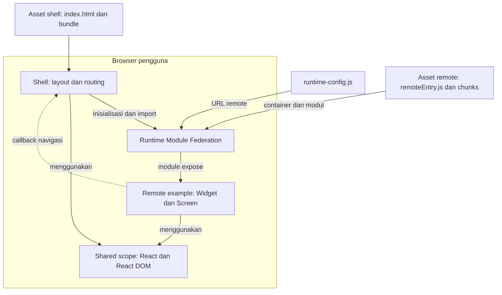

# MicroFE boilerplate

Boilerplate React + TypeScript dengan Webpack Module Federation. Shell memuat widget dan screen dari satu remote contoh. Styling komponen memakai CSS Modules. Remote dapat dijalankan sendiri dan dibuild terpisah.

## Arsitektur

Diagram berikut memperlihatkan integrasi saat aplikasi berjalan di browser. Shell dan remote menghasilkan asset terpisah; hosting dapat dipilih sesuai kebutuhan proyek.



Shell membaca URL remote dari runtime config. Federation memuat container `remoteEntry.js`, menginisialisasi shared scope, dan menyediakan module yang diekspos remote. Import melalui `React.lazy` memuat komponen widget atau screen; `Suspense` menampilkan loading, dan error boundary menampilkan fallback jika pemuatan atau render komponen gagal.

Remote mengelola state dan logic fitur, lalu meminta navigasi melalui callback dari shell. Shell menentukan perubahan URL. React dan React DOM dibagi lewat shared scope; setiap aplikasi tetap memiliki fallback dependency agar remote bisa berjalan standalone.

| Bagian                      | Tanggung jawab                                                                   |
| --------------------------- | -------------------------------------------------------------------------------- |
| `apps/shell`                | Layout, navigasi hash, komposisi remote, loading dan error fallback              |
| `apps/example`              | Widget dan screen contoh, state fitur, entry standalone                          |
| `packages/contracts`        | Tipe props dan callback sebagai batas integrasi                                  |
| `packages/ui`               | Komponen UI lokal yang dibundel oleh aplikasi pemakainya                         |
| `config/runtime-config.cjs` | Validasi environment dan URL remote, pembuatan konfigurasi publik                |
| `webpack.common.cjs`        | Konfigurasi build, expose/import Federation, shared dependencies dan CSS Modules |

UI dan contracts dihubungkan melalui npm workspaces saat development/build. Keduanya tidak diambil dari server dependency saat runtime. Shared scope adalah mekanisme runtime Federation, bukan aplikasi terpisah. Remote berjalan di konteks JavaScript browser yang sama dengan shell.

## Fondasi boilerplate

Boilerplate ini menyediakan pola yang bisa dipakai ulang tanpa domain bisnis tertentu:

- Shell dan satu remote contoh yang bisa dibuild dan dijalankan terpisah.
- Contract props/callback yang jelas; remote berkomunikasi dengan shell melalui contract.
- Konfigurasi development, staging dan production, dengan URL remote yang bisa diganti setelah build.
- Shared React dengan pemeriksaan versi, CSS Modules, ESLint dan Prettier.
- Loading, error fallback, tes standalone/integrasi, serta CI.

Untuk memakai boilerplate pada proyek baru, ganti fitur example, tentukan prefix route tiap remote, dan isi URL deployment. Auth, API client, state management, design tokens, logging, serta pipeline deployment dipilih sesuai kebutuhan proyek. Versi contract dan aturan rollback perlu disepakati sebelum remote dirilis oleh tim yang berbeda.

## Mulai

Gunakan Node.js 24 (`nvm use`), lalu:

```sh
npm ci
npm run dev
```

- Shell: http://localhost:3000
- Remote example: http://localhost:3001

Klik **Buka screen remote** untuk berpindah dari widget dashboard ke screen remote. Shell mengatur URL; remote menerima callback navigasi melalui contract.

## Struktur

```text
apps/shell       Layout, navigasi, runtime config, loading/error boundary
apps/example     Widget dan screen contoh, entry standalone
packages/ui      Komponen UI lokal untuk kedua aplikasi
packages/contracts  Tipe props untuk integrasi shell dan remote
scripts          Development, preview, validasi versi React
```

`packages/ui` dan `packages/contracts` adalah package workspace, bukan aplikasi atau server dependency tambahan. Keduanya disertakan pada build aplikasi yang menggunakannya.

## Shared dependencies

Konfigurasi ada di `webpack.common.cjs`. React dan React DOM memakai `singleton: true` agar runtime Federation menggunakan satu instance shared, `requiredVersion` dari manifest aplikasi, dan `strictVersion: true` agar versi yang tidak cocok ditolak. Setiap aplikasi tetap memiliki dependency dan fallback bundle sendiri untuk dapat berjalan standalone.

Gunakan versi React dan React DOM yang sama pada kedua manifest. `npm run check:dependencies` memeriksa kesesuaiannya. Library lain dapat menggunakan versi berbeda selama tidak bergantung pada identitas instance global yang sama.

## Konfigurasi remote

Shell membaca `runtime-config.js` sebelum menjalankan bundle. Webpack membuat file ini dari `MICROFE_ENV` dan `MICROFE_EXAMPLE_URL`; hanya kedua field publik yang diteruskan ke browser. Jangan memasukkan token atau secret ke konfigurasi frontend.

Tanpa konfigurasi tambahan, environment adalah `development` dengan remote di `http://localhost:3001/remoteEntry.js`. Untuk konfigurasi lokal, salin `.env.example` menjadi `.env.local`, lalu isi nilainya dan restart development server. Environment dari shell atau CI mengambil prioritas atas `.env.local`.

| Environment   | URL remote                                             |
| ------------- | ------------------------------------------------------ |
| `development` | Default localhost, bisa diganti dengan HTTP atau HTTPS |
| `staging`     | Wajib URL HTTPS milik deployment staging Anda          |
| `production`  | Wajib URL HTTPS milik deployment production Anda       |

Contoh build staging di macOS/Linux:

```sh
MICROFE_ENV=staging MICROFE_EXAMPLE_URL=https://remote-staging.your-domain.com/remoteEntry.js npm run build
```

Untuk Windows, isi `.env.local` atau atur environment melalui terminal/CI. Nama environment yang tidak dikenal, URL tidak valid, dan konfigurasi staging/production tanpa URL HTTPS membuat build shell gagal.

Untuk mengganti environment pada build yang sudah tersedia tanpa rebuild bundle:

```sh
MICROFE_ENV=production MICROFE_EXAMPLE_URL=https://remote.your-domain.com/remoteEntry.js npm run configure
```

Upload file `apps/shell/dist/runtime-config.js` yang dihasilkan ke deployment shell. Script `configure` membutuhkan build shell sebelumnya. Anda juga dapat memperbarui file runtime tersebut langsung di hosting.

Remote mengekspos `example/Widget` dan `example/Screen`. Untuk menambah remote, tambahkan app, nama container yang unik, konfigurasi `remotes`, deklarasi TypeScript, dan route atau area komposisinya.

Remote berjalan dengan hak akses JavaScript yang sama dengan shell. Gunakan hanya URL remote yang dipercaya, HTTPS di production, dan aturan CSP sesuai origin deployment. Authorization tetap harus ditegakkan di backend. Boilerplate ini belum menyediakan auth, API, atau konfigurasi production untuk hosting tertentu.

## CSS isolation

Shell, remote, dan UI memakai `*.module.css`. Import style sebagai object dan gunakan `className={styles['nama-class']}`. Class hasil build diberi hash serta namespace per aplikasi, sehingga selector remote tidak menargetkan class biasa milik fitur lain.

`apps/shell/src/global.css` hanya mengatur margin dokumen. Remote tidak boleh menambahkan selector global seperti `body`, `button`, atau `:global(...)`. CSS Modules membatasi selector, tetapi properti seperti font dan color tetap bisa diwariskan dari shell. Ini bukan sandbox CSS atau batas keamanan; gunakan Shadow DOM jika membutuhkan isolasi penuh.

## Standar kode

ESLint memeriksa JavaScript/TypeScript, penggunaan React Hooks, dan JSX. Prettier menangani format; aturan formatting yang bertabrakan dinonaktifkan melalui `eslint-config-prettier`.

```sh
npm run lint
npm run lint:fix
npm run format
npm run format:check
```

CI menjalankan lint tanpa warning dan format check melalui `npm run check`.

## Build dan verifikasi

```sh
npm run build
npm run preview
```

Build ada di masing-masing `apps/*/dist`. Deploy keduanya sebagai static assets; jangan menggabungkan direktori hasil build. Pertahankan chunk lama selama masih ada pengguna yang memuat versi sebelumnya. Hindari cache panjang untuk `remoteEntry.js` dan `runtime-config.js`; chunk dengan nama hash dapat dicache lebih lama.

```sh
npx playwright install chromium
npm run check
```

`check` menjalankan lint, format check, validasi dependency, TypeScript, tes konfigurasi environment, production build, dan tes browser. Tes mencakup remote nyata, callback navigasi, deep link, standalone remote, error fallback, route tidak dikenal, runtime URL, deployment shell di subpath, dan CSS isolation. `npm test` memerlukan hasil build sebelumnya. CI menjalankan proses yang sama.

Build aplikasi secara terpisah:

```sh
npm run build --workspace @microfe/shell
npm run build --workspace @microfe/example
```

Routing memakai hash sehingga static hosting tidak membutuhkan rewrite untuk deep link. Script preview hanya untuk verifikasi lokal.

## Deploy

Shell dan remote adalah dua aplikasi static yang bisa dirilis masing-masing. Gunakan dua project hosting atau dua direktori pada web server. Tidak perlu menjalankan Node.js di server untuk menyajikan hasil build.

Contoh URL di bawah adalah placeholder; ganti dengan domain deployment Anda:

| Aplikasi       | URL contoh                        | Folder yang dipublikasikan |
| -------------- | --------------------------------- | -------------------------- |
| Remote example | `https://remote.your-domain.com/` | `apps/example/dist`        |
| Shell          | `https://app.your-domain.com/`    | `apps/shell/dist`          |

### 1. Siapkan build

Jalankan dari root repo menggunakan Node.js 24 dan konfigurasi development (URL remote localhost). Jika `.env.local` atau environment terminal sudah berisi nilai production, kembalikan ke development sebelum checks.

```sh
npm ci --include=dev
npx playwright install chromium
npm run check
```

Build membutuhkan devDependencies seperti Webpack dan TypeScript. `npm run check` memverifikasi integrasi lokal menggunakan URL localhost; buat build shell production setelah pemeriksaan ini.

### 2. Deploy remote terlebih dahulu

```sh
npm run build --workspace @microfe/example
```

Upload seluruh isi `apps/example/dist` ke hosting remote, termasuk `index.html`, `remoteEntry.js`, semua chunk JavaScript, dan file pendukung. Jangan hanya mengupload `remoteEntry.js`.

Catat URL lengkap container, misalnya `https://remote.your-domain.com/remoteEntry.js`. Pastikan endpoint tersebut mengembalikan JavaScript dan dapat dimuat dari browser pengguna. Jika hosting memiliki proteksi login untuk preview, pemuatan remote dari shell juga harus memiliki akses yang sesuai.

### 3. Build dan deploy shell

Atur URL remote yang sudah tersedia, lalu build shell. Contoh macOS/Linux:

```sh
MICROFE_ENV=production MICROFE_EXAMPLE_URL=https://remote.your-domain.com/remoteEntry.js npm run build --workspace @microfe/shell
```

Di Windows atau dashboard hosting, isi dua environment variable tersebut melalui konfigurasi platform. Alternatif lokal: isi `.env.local` dengan `MICROFE_ENV=production` dan `MICROFE_EXAMPLE_URL` yang sama, lalu jalankan perintah build shell.

Upload seluruh isi `apps/shell/dist` ke hosting shell. Pastikan `runtime-config.js` berada di samping `index.html`; file itu harus menunjuk ke URL remote production, bukan localhost.

Jika platform hosting melakukan build langsung dari Git, gunakan konfigurasi berikut untuk kedua project:

| Pengaturan        | Project remote                               | Project shell                                                        |
| ----------------- | -------------------------------------------- | -------------------------------------------------------------------- |
| Working directory | Root repo                                    | Root repo                                                            |
| Runtime build     | Node.js 24                                   | Node.js 24                                                           |
| Install command   | `npm ci --include=dev`                       | `npm ci --include=dev`                                               |
| Build command     | `npm run build --workspace @microfe/example` | `npm run build --workspace @microfe/shell`                           |
| Output directory  | `apps/example/dist`                          | `apps/shell/dist`                                                    |
| Environment       | Tidak membutuhkan URL shell                  | `MICROFE_ENV=production`, `MICROFE_EXAMPLE_URL=<URL remoteEntry.js>` |

Working directory tetap root repo agar npm workspaces menemukan UI, contracts, dan lockfile. Pilih mode static hosting jika platform meminta jenis aplikasi. Workflow CI saat ini menjalankan pemeriksaan; proses upload/deploy diatur melalui hosting yang Anda pilih.

### 4. Atur asset dan cache

Sajikan file JavaScript dengan MIME type yang benar dan kembalikan `404` untuk chunk yang tidak ditemukan. Jangan mengarahkan request asset yang hilang ke `index.html`. Routing hash seperti `/#/example` tidak membutuhkan SPA rewrite.

| Asset pada URL yang tetap                           | Header cache yang disarankan                         |
| --------------------------------------------------- | ---------------------------------------------------- |
| `index.html`, `runtime-config.js`, `remoteEntry.js` | `Cache-Control: no-cache`                            |
| Chunk dengan nama hash                              | `Cache-Control: public, max-age=31536000, immutable` |

`no-cache` mengizinkan penyimpanan tetapi meminta revalidasi sebelum digunakan kembali. Jika CDN memiliki aturan cache terpisah, sesuaikan juga aturan CDN. Pertahankan chunk lama selama masih ada pengguna yang membuka versi sebelumnya.

Shell dan remote juga dapat ditempatkan pada subpath, misalnya `/app/` dan `/example/`. Gunakan URL container lengkap `https://your-domain.com/example/remoteEntry.js`, pertahankan struktur folder hasil build, dan redirect URL direktori tanpa slash ke versi dengan slash (`/app/`). Webpack menggunakan `publicPath: 'auto'` untuk mencari chunk dari lokasi script; file runtime config shell memakai path relatif.

### 5. Verifikasi deployment

- Buka remote sendiri dan pastikan widget serta screen dapat digunakan.
- Buka shell, klik counter widget, lalu **Buka screen remote** dan **Kembali ke dashboard**.
- Buka langsung URL shell dengan `/#/example`, lalu refresh.
- Periksa Network: `runtime-config.js`, `remoteEntry.js`, dan chunk berhasil dimuat dari lokasi deployment yang benar.
- Periksa Console: tidak ada kegagalan chunk atau ketidakcocokan versi shared dependency.

`npm run preview` adalah server verifikasi lokal, bukan perintah untuk hosting production.

### 6. Update dan rollback

Jika contract dan shared dependencies tetap kompatibel, remote bisa dirilis tanpa rebuild shell. Simpan versi remote pada deployment atau direktori yang tetap tersedia, misalnya `https://remote.your-domain.com/releases/v1/remoteEntry.js`.

Untuk mengarahkan shell ke versi lain, gunakan hasil build shell yang sudah tersedia:

```sh
MICROFE_ENV=production MICROFE_EXAMPLE_URL=https://remote.your-domain.com/releases/v1/remoteEntry.js npm run configure
```

Upload hanya `apps/shell/dist/runtime-config.js` yang diperbarui, lalu lakukan revalidasi/purge file tersebut jika dibutuhkan oleh CDN. Tab yang sudah memuat remote perlu reload untuk mengambil konfigurasi baru. Untuk rollback shell, pulihkan satu paket asset shell yang lengkap beserta runtime config yang kompatibel.

Jangan menghapus versi remote lama sebelum pengguna versi shell sebelumnya selesai menggunakannya. Perubahan yang memutus contract atau versi shared React perlu dirilis secara terkoordinasi.

Referensi: [Webpack public path](https://webpack.js.org/guides/public-path/) dan [HTTP Cache-Control](https://developer.mozilla.org/en-US/docs/Web/HTTP/Reference/Headers/Cache-Control).

## Docker / container

Dockerfile multi-stage menyediakan dua target: `shell` dan `example`. Node.js 24 membuild aplikasi; Nginx menyajikan hasil build pada port `8080`. Image shell juga menyertakan Node untuk membuat `runtime-config.js` sekali saat startup, menggunakan validator yang sama dengan static build. Tidak ada development server atau `node_modules` aplikasi pada image runtime.

### Jalankan lokal dengan Compose

Install Docker dengan plugin Compose, lalu jalankan dari root repo:

```sh
docker compose up --build --wait
```

- Shell: http://localhost:3000
- Remote: http://localhost:3001
- Health endpoint setiap aplikasi: `/health`

Compose menunggu remote healthy sebelum memulai shell. Default Compose adalah environment `development` dengan remote HTTP localhost, sedangkan bundle tetap dibuild dengan optimasi production. URL remote diakses oleh browser; jangan menggunakan hostname internal Compose seperti `http://example:8080` untuk `MICROFE_EXAMPLE_URL`.

Untuk memeriksa alur integrasi terhadap container yang sudah berjalan:

```sh
npm ci
npx playwright install chromium
MICROFE_TEST_TARGET=container npm test
```

Pada Windows, atur `MICROFE_TEST_TARGET=container` melalui environment terminal sebelum `npm test`. Tes ini tidak memulai server preview; container harus sudah tersedia pada port `3000` dan `3001`.

Untuk menghentikan container:

```sh
docker compose down
```

### Build dan jalankan image terpisah

```sh
docker build --target example -t microfe-example:v1 .
docker build --target shell -t microfe-shell:v1 .
docker run -d --name microfe-example -p 3001:8080 microfe-example:v1
```

Untuk percobaan lokal dengan shell HTTP:

```sh
docker run -d --name microfe-shell -p 3000:8080 \
  -e MICROFE_ENV=development \
  -e MICROFE_EXAMPLE_URL=http://localhost:3001/remoteEntry.js \
  microfe-shell:v1
```

### Jalankan production

Deploy image remote di platform container Anda dan sediakan endpoint HTTPS yang dapat diakses browser. Setelah itu jalankan shell dengan URL remote tersebut:

```sh
docker run -d --name microfe-shell-prod -p 8080:8080 \
  -e MICROFE_ENV=production \
  -e MICROFE_EXAMPLE_URL=https://remote.your-domain.com/remoteEntry.js \
  microfe-shell:v1
```

Domain di atas adalah placeholder. Gunakan reverse proxy atau load balancer untuk HTTPS di depan port `8080`; image Nginx ini tidak menyiapkan sertifikat TLS. Untuk staging, gunakan `MICROFE_ENV=staging` dan URL HTTPS staging.

Image shell secara default memakai environment `production`, sehingga tidak dapat startup tanpa URL remote yang valid. Mengganti environment/URL dilakukan dengan membuat ulang container dari image yang sama; tidak perlu rebuild image. Konfigurasi disimpan di filesystem container saat startup, bukan di layer image. Jangan menjalankan shell dengan filesystem read-only tanpa menyediakan writable mount untuk direktori HTML dan direktori kerja Nginx.

Nginx menyediakan health check, `404` untuk asset yang hilang, revalidasi HTML/runtime config/container entry, dan cache immutable untuk chunk bernama hash. Deployment remote baru tetap harus mempertahankan chunk lama atau memakai URL versi yang tetap tersedia, sebagaimana panduan rollback di atas.

CI membuild kedua image, menjalankan Compose, menguji browser serta HTTP/cache headers terhadap Nginx, dan memastikan konfigurasi production yang tidak lengkap menghentikan startup shell. CI memverifikasi image; publikasi ke registry dan deployment production ditentukan oleh platform yang Anda gunakan.
